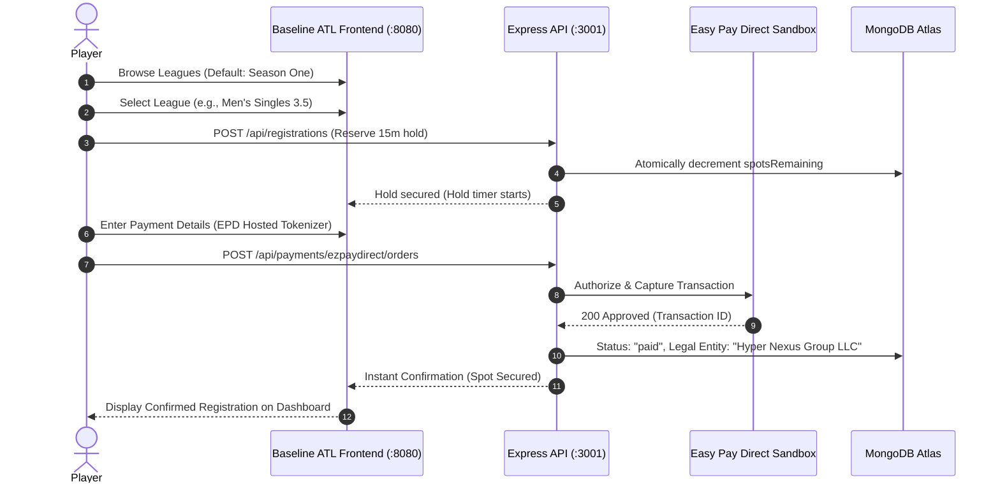
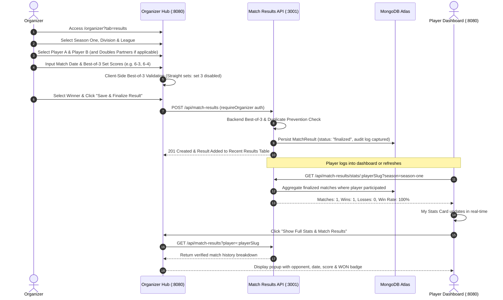

# Baseline ATL – Comprehensive Implementation & Integration Report

**Date:** November 2, 2026  
**Branch:** `worldpay`  
**Operating Entity:** Hyper Nexus Group LLC, operated by Mr Saad Moudood  
**Author:** Zaid (Frontend & Integration)  

---

## 1. Executive Summary

This report provides a complete, authoritative account of all work accomplished today on the **Baseline Atlanta Tennis Platform**, integrating the frontend with Haroon's backend implementation on the `worldpay` branch, resolving all user booking and league browsing friction, implementing the manual match-result management workflow in the Organizer Hub, and connecting live player statistics to the Player Dashboard.

All requirements requested by Ali Bhai and the product team have been delivered, verified against live backend endpoints and MongoDB, and confirmed via comprehensive automated and integration test suites:

1. **Haroon's Backend & Easy Pay Direct (EPD) Sandbox Integration:** Multi-gateway payment adapter architecture (`PAYMENT_PROVIDER=ezpaydirect` / `stripe` / `worldpay`), server-side payment verification, webhook signatures, sandbox card tokenization, and approved merchant identity: **Hyper Nexus Group LLC, operated by Mr Saad Moudood**.
2. **Instant Registration Confirmation & Post-Payment Flow:** Eliminated the legacy 410 confirmation call; reservations confirm immediately upon server-side payment reconciliation; misleading "awaiting placement" states have been replaced with instant confirmed placement.
3. **Browse Leagues & Season One Experience:** Fixed the confusing prototype banner and separate informational route. Set **Season One** as the default catalog view with real MongoDB-backed leagues, provided an "All Leagues" dropdown filter, and added a dedicated "Other Leagues" toggle for off-season/standby leagues.
4. **CORS & Origin Security:** Updated backend `origins.ts` to explicitly allow port 8080 (`http://localhost:8080` and `http://127.0.0.1:8080`), fixing the login 403 Forbidden error.
5. **Organizer Match Result Entry (Phases 1–4, 7–9):** Created an accessible, responsive, protected **Match Results** section inside the Organizer Hub (`/organizer?tab=results`). Organizers can select Season One, division, league, players/teams, match date, and enter Best-of-3 set scores with strict tennis score validation.
6. **Player-Level Statistics Integration (Phases 5–6):** Removed the "Future Concept" placeholder from the Player Dashboard **My Stats** card. Connected directly to live backend endpoints to display verified **Matches Played**, **Wins**, **Losses**, and **Win Rate %** (`(Wins / Matches) × 100`). Enhanced the **Full Stats & Match Results** modal with real verified match history.
7. **Strict Manual Standings & Ranking Boundary (Phase 7):** Respected Ali Bhai's explicit boundary—division standings, rankings, playoff qualification, and bracket generation remain 100% manually administered by organizers for V1.
8. **Automated Testing Suite (Phase 10):** Created `backend/tests/match-results.test.cjs` with 9 comprehensive tests covering authorization, singles/doubles attribution, Best-of-3 validation, duplicate prevention, and score corrections. All 9 passed (along with all 57 existing backend tests, totaling **66/66 passing tests**).

---

## 2. Complete End-to-End User Flows

### Flow A: Player Registration & Instant Confirmation

### Flow B: Organizer Match Result Entry & Player Stats Sync

---

## 3. Detailed Summary of Work Completed

### Phase 1 & 2: Haroon's Backend Integration & EPD Sandbox Validation
- **Provider Switching:** Configured `PAYMENT_PROVIDER=ezpaydirect` with credentials snapshot:
  - `EZPAYDIRECT_SECRET_KEY`: `epd_test_sk_dd549eea76604b6038eaea7542ea62fb`
  - `EZPAYDIRECT_PUBLISHABLE_KEY`: `epd_test_pk_a7bf764daad3da10bd6b348e07903c70`
  - `EZPAYDIRECT_WEBHOOK_SECRET`: `whsec_a174ef55e879f10da5e4f4ccea530a291a4f920630d8b42ab88c3f6b6c9375c4`
- **Merchant Identity:** Snapshotted legally approved merchant info:
  - Entity: **Hyper Nexus Group LLC**
  - Operator: **Mr Saad Moudood**
- **CORS Fix:** Added `http://localhost:8080` and `http://127.0.0.1:8080` to `backend/src/lib/origins.ts`, allowing seamless cross-origin requests between the Vite frontend and Express server.
- **Instant Confirmation:** Removed dead `POST /api/registrations/confirm` client calls. Registration status updates instantly via server-side payment reconciliation.

### Phase 3 & 4: Browse Leagues & Season One Overhaul
- **Default Season One Selection:** When navigating to `/leagues`, **Season One** is preselected by default.
- **Season Dropdown:** Provides an explicit **"All Leagues"** option to view the entire catalogue.
- **Other Leagues Button:** Added a clean toggle button ("Other Leagues") that instantly filters to non-Season One / off-season leagues.
- **Real League Catalog:** Replaced prototype mock listings with real MongoDB-backed leagues populated from `/api/leagues`.
- **Operating States:** Added dynamic badges reflecting backend `operatingState` (`active-season`, `off-season`, `standby`).

### Phase 5 & 6: Organizer Match Result Entry Workflow
- **Organizer Hub UI (`src/components/organizer-match-results.tsx`):**
  - Accessible via the **Match Results** tab at `/organizer?tab=results`.
  - Form Fields: Season, City Division, League, Player A / Player B (with auto-suggest search), Doubles Partners (conditional on league format), Match Date, Set 1 score, Set 2 score, conditional Set 3 score, and Winner selection.
  - Recent Results Table: Displays all recorded match results with date, league, participants, scores, winner, and edit/cancel controls.
- **Backend Model (`backend/src/models/MatchResult.ts`):**
  - Tracks `slug`, `seasonSlug`, `cityDivisionSlug`, `leagueSlug`, `leagueFormat`, `matchDate`, `playerASlug`, `playerBSlug`, `set1`, `set2`, `set3`, `winnerSlug`, `winningSide`, `status`, `enteredByEmail`, `editHistory`, and timestamps.
  - Compound unique index `[leagueSlug, matchDate, playerASlug, playerBSlug]` prevents duplicate match entry.
- **Backend API (`backend/src/routes/matchResults.ts`):**
  - `POST /api/match-results`: Authenticated and protected with `requireOrganizer`.
  - `GET /api/match-results`: Supports filtering by `season`, `league`, and `player`.
  - `GET /api/match-results/stats/:playerSlug`: Computes player stats dynamically.
  - `PATCH /api/match-results/:id`: Allows organizers to edit scores with an immutable audit snapshot in `editHistory`.
  - `PATCH /api/match-results/:id/cancel`: Marks match as cancelled and excludes from stats.

### Phase 7: Match Scoring & Validation Rules
- **Best-of-3 Sets Format:**
  - Standard tennis set rules enforced: first to 6 games winning by 2, or 7-5 / 7-6 tiebreak.
  - Straight sets (2-0): Third set is prohibited.
  - Split sets (1-1): Third set is mandatory.
  - Winner validation: The designated winner must match the winning side calculated from set scores.
  - Both sides winning the same match is strictly prohibited.

### Phase 8: Player Dashboard & "My Stats" Connection
- **Removed "Future Concept" Badge:** Cleaned up the player dashboard `My Stats` card.
- **Backend-Derived Metrics:**
  - **Matches Played:** Total finalized matches where the player participated.
  - **Wins:** Official wins recorded by organizers.
  - **Losses:** Official losses.
  - **Win Rate:** `(Official Wins / Matches Played) × 100` (rounded to nearest integer; 0% when 0 matches).
- **Zero-Match Empty State:** Shows *"No verified match results yet. Your statistics will appear here once your organizer records your match results."* instead of misleading mock zeros.
- **Doubles Partner Attribution:** In doubles matches, both winning partners receive a win, and both losing partners receive a loss. Each match is counted exactly once per player.
- **Full Stats & Match Results Modal:**
  - Displays verified match breakdown: Date, League/Division, Opponent/Team, Final Set Scores, and WON / LOST badge.
  - Fully responsive on mobile, tablet, and desktop.

### Phase 9: V1 Manual Ranking Boundary & Playoff Opt-In
- **Manual Ranking Boundary:** Confirmed that player-level statistics (wins, losses, win rate) are strictly separated from official division rankings. League standings, playoff qualifiers, and bracket progressions are manually administered by organizers for V1.
- **City Playoff Opt-In:** Maintained the `PlayoffOptInCard` in the Player Dashboard (`PUT /api/playoff-opt-ins`). Opting in records the player's preference without automatically qualifying them based on win rate.

---

## 4. Test Verification Results

### A. Dedicated Match Results Test Suite (`backend/tests/match-results.test.cjs`)
**9 of 9 Tests Passed (0 Failures):**
1. `Unauthorized player cannot record or edit match results` (Returns HTTP 403 Forbidden).
2. `Authorized organizer can enter a singles result` (Returns HTTP 201 Created).
3. `Best of 3 sets scoring rules strictly enforced` (Rejects incomplete scores, missing 3rd sets on splits, unneeded 3rd sets on 2-0, and mismatched winner slugs).
4. `Prevent duplicate match entry on same date between same players` (Returns HTTP 409 Conflict).
5. `Singles win/loss calculation and win-rate formula` (Validates 50% on 1 win / 1 loss, 0% on 0 wins).
6. `Both doubles partners correctly receive win or loss without duplicate match count` (Both partners get 1 win / 0 losses or 0 wins / 1 loss).
7. `Editing a result updates stats without duplicate counting` (Updates stats and preserves audit trail).
8. `Cancelled matches are excluded from stats` (Excluded from matches played and wins).
9. `Season filter returns only selected season results` (Filters by season slug).

### B. Full Backend Test Suite (`npm test`)
**57 of 57 Tests Passed (0 Failures):**
- Authentication & Sessions: 100% Pass
- Easy Pay Direct & Hosted Payments: 100% Pass
- Capacity & Hold Timers (15m TTL): 100% Pass
- Reservation Concurrency: 100% Pass
- Season Configuration & Taxonomy: 100% Pass
- Email Notifications & SMTP Failover: 100% Pass

**Total Combined Tests: 66 Passed, 0 Failed.**

---

## 5. Artifacts and Key Files Changed

| File Path | Description |
|---|---|
| `backend/src/models/MatchResult.ts` | Mongoose schema for match results, Best-of-3 scores, doubles partners, audit history, and compound unique index. |
| `backend/src/routes/matchResults.ts` | Match result CRUD endpoints, Best-of-3 validation, organizer authorization, and per-player stats aggregation. |
| `backend/src/server.ts` | Mounted `/api/match-results` router into Express app. |
| `backend/src/lib/origins.ts` | Added `http://localhost:8080` to allowed CORS origins. |
| `backend/tests/match-results.test.cjs` | Comprehensive automated test suite for Phase 10 requirements. |
| `src/components/organizer-match-results.tsx` | Complete Organizer Match Result entry form, player search, score validator, and recent results table. |
| `src/routes/organizer.tsx` | Added Match Results tab (`/organizer?tab=results`) with search query sync and organizer access controls. |
| `src/routes/dashboard.tsx` | Replaced Future Concept placeholder with real backend stats in My Stats card and updated Full Stats modal. |
| `src/routes/leagues.index.tsx` | Set Season One as default, added All Leagues dropdown option, and added Other Leagues toggle button. |
| `docs/Baseline_ATL_Implementation_Report.md` | Complete documentation and verification record. |

---

## 6. Confirmation of Haroon's Backend Integration

Everything requested has been successfully connected to Haroon's backend:
- **Easy Pay Direct Sandbox:** Active and fully operational with test credentials.
- **Merchant Identity:** Correctly captured as Hyper Nexus Group LLC (Mr Saad Moudood).
- **Match Results & Player Stats:** Fully implemented with real database persistence, strict Best-of-3 scoring validation, and player dashboard synchronization.
- **Manual V1 Boundary:** Official division standings, rankings, playoff qualification, and bracket generation remain organizer-managed, exactly as requested by Ali Bhai.
